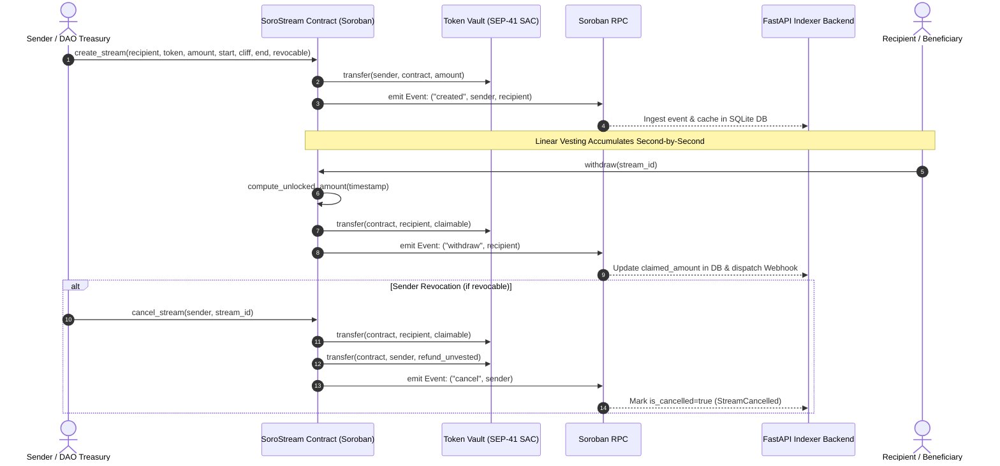

# SoroStream Smart Contracts 🌊

> **Trustless, per-second linear asset streaming and cliff vesting smart contracts on Soroban (Stellar Network).**

[](https://github.com/HassanKorey/SoroStream-contract/actions)
[](LICENSE)
[](https://stellar.expert/explorer/testnet/contract/CA4L7T6R74G3T5F5V7V7RWWUHE2J76Y4WJ3L7C2WJ3L7C2WJ3L7C2WJ3)
[](https://soroban.stellar.org)

📖 **Documentation Portal**: [https://HassanKorey.github.io/SoroStream-app](https://HassanKorey.github.io/SoroStream-app)  
🖥️ **Frontend & Indexer Workspace**: [HassanKorey/SoroStream-app](https://github.com/HassanKorey/SoroStream-app)  
🚀 **Live Web3 Application**: [https://soro-stream.vercel.app](https://soro-stream.vercel.app)

---

## 🌟 Overview

`SoroStream-contract` is the pure Rust workspace containing the Soroban smart contracts (`contracts/vesting_stream`) for the **SoroStream** protocol on **Stellar**.

Written in `#![no_std]` Rust with `soroban-sdk` v21.0.0, the contract provides trustless continuous asset streaming, cliff enforcement, optional sender revocation with unvested refunds, and atomic multi-recipient batch distributions for SEP-41 Soroban Asset Contracts (SAC) such as XLM and USDC.

---

## 👥 Maintainer Governance

| Name | Role | GitHub | Contact |
| :--- | :--- | :--- | :--- |
| Hassan Akorede (EDUN) | Lead Architect | [@HassanKorey](https://github.com/HassanKorey) | Telegram: `@HassanKorey` |
| Co-Maintainer | Smart Contract Reviewer | [@CoMaintainer](https://github.com/CoMaintainer) | Discord: `comaintainer#0001` |

---

## 📍 Deployed Contract Address & Explorer

| Contract | Network | Address & Stellar Expert Link |
| :--- | :--- | :--- |
| `vesting_stream` | Stellar Testnet | [`CA4L7T6R74G3T5F5V7V7RWWUHE2J76Y4WJ3L7C2WJ3L7C2WJ3L7C2WJ3`](https://stellar.expert/explorer/testnet/contract/CA4L7T6R74G3T5F5V7V7RWWUHE2J76Y4WJ3L7C2WJ3L7C2WJ3L7C2WJ3) |

- **Compiled WASM SHA-256 Hash**: `744f4b889771e3e8581093d0e796656686e94c30aefcbffd646fed848fe4c25d`

---

## 📐 Architecture Sequence Diagram



---

## ⚡ Mathematical Specification

The smart contract calculates unlocked tokens dynamically on invocation without needing periodic cron jobs or per-second storage writes. Let $t$ be the current ledger timestamp (`env.ledger().timestamp()`):

$$\text{Unlocked}(t) = \begin{cases} 
0 & \text{if } t < t_{\text{cliff}} \\
A_{\text{total}} & \text{if } t \ge t_{\text{end}} \\
\left\lfloor \frac{A_{\text{total}} \times (t - t_{\text{start}})}{t_{\text{end}} - t_{\text{start}}} \right\rfloor & \text{otherwise}
\end{cases}$$

$$\text{Claimable}(t) = \text{Unlocked}(t) - A_{\text{claimed}}$$

---

## 🛠️ Build & Test Instructions

### 1. Run Unit Tests
```bash
cargo test --workspace
```

### 2. Run Clippy Linting
```bash
cargo clippy --workspace --all-targets -- -D warnings
```

### 3. Compile WASM Target
```bash
cargo build --package vesting_stream --target wasm32-unknown-unknown --release
```

---

## 👥 Contributors

<a href="https://github.com/HassanKorey/SoroStream-app/graphs/contributors">
  
</a>

---

## 📄 License

MIT License. See [LICENSE](LICENSE) for details.
